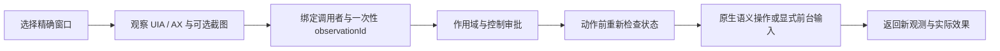

# DSH Computer Use Fusion

[English](README.en.md) · [验证记录](docs/VALIDATION.md) · [来源与许可证](THIRD_PARTY_NOTICES.md)

把四个社区项目中互补的能力整合成一个 DeepSeek Harness 插件：原生 Windows
UIA、macOS Accessibility、可选 cua-driver，以及带准确坐标映射的视觉截图。
统一提供 13 个 `fusion_*` 工具，采用 MIT 许可证。当前版本为 **0.1.0 初始版本**。

这是独立整合项目，与 DeepSeek 及原作者没有官方关联。

## 整合了什么

| 来源 | 融合方式 |
| --- | --- |
| Anionex/dsh-computer-use | 保留 Swift 原生 macOS helper 与源码；借鉴观测 ID、句柄、状态校验与权限分层。 |
| 988hj7tczd-oss/dsh-computer-use | 复用 cua-driver 定位与会话恢复代码；作为可选驱动，提供独立虚拟光标路径。 |
| Yu-tao-Li/dsh-computer-use-win | 集成持久化 PowerShell UIA 后端、后台语义操作、原生窗口捕获与本地 OCR。 |
| xie129716/computer-user-vision | 融合真实图片附件、像素预算、宿主缩放后的坐标映射，并避开已移除的 settings API。 |

没有直接拼装四套同名工具，也没有复制原项目的 API key fallback、LLM adapter
包装器或控制 HTTP 路由。来源版本、版权与修改说明见 THIRD_PARTY_NOTICES.md。

## 安装

要求 Node.js **22.19+ 或 24+**，DSH **0.2.0-rc.2**。
`0.2.1-alpha.2` 已通过宿主接口测试；完整验证范围见验证记录。

```powershell
git clone https://github.com/cqupi/dsh-computer-use-fusion.git
cd dsh-computer-use-fusion
npm ci
npm run check
npm test
node scripts/doctor.mjs
dsh plugin --profile web add .
```

也可从 Git 安装（尚未发布 npm 包）：

```text
dsh plugin --profile web add git+https://github.com/cqupi/dsh-computer-use-fusion.git
# Headless profile:
dsh plugin --profile headless add git+https://github.com/cqupi/dsh-computer-use-fusion.git
```

重启 DSH 宿主，创建新会话，加载 `/dsh-computer-use-fusion`。
让模型先调用 `fusion_health`、`fusion_list_windows`，选择明确窗口，再调用
`fusion_observe`。默认首次控制每个窗口需通过 DSH approval 服务获得本轮授权。
如果宿主 approval policy 为 `never`，需要用户调整权限预设或手动操作。

## 工作方式



每个快照绑定 Agent 对象身份，避免同一会话的不同 Agent 共用编号。整套桌面事务
串行执行；动作前校验状态、TTL 和窗口身份；旧 ID 在动作前消耗。高影响操作由
`sensitive=true` 加一次性审批，危险标签检测提供额外防线。密码控件拒绝自动输入。

坐标始终使用**工具返回图片的像素**。插件按 `mapping.origin` 和
`mapping.screenPerPixel` 一次换算到后端坐标，包括附件服务再次缩放的情况。
树模式的动作后观测不带图片；下一次坐标操作前需重新请求 `screenshot=true`。

## 工具

| 工具 | 用途 |
| --- | --- |
| `fusion_health` / `fusion_list_windows` | 后端诊断与目标发现 |
| `fusion_observe` | UIA/AX 树、观测 ID、元素句柄、可选窗口截图 |
| `fusion_click` | 元素点击或图片坐标点击，支持右键及双击 |
| `fusion_type` / `fusion_key` | 文本与快捷键 |
| `fusion_set_value` / `fusion_invoke` | 精确元素的原生语义操作 |
| `fusion_scroll` / `fusion_drag` | 滚动与拖拽 |
| `fusion_activate` | Windows 精确窗口激活 |
| `fusion_ocr` | Windows 本地 OCR，输出屏幕坐标 |
| `fusion_stop` | 写入停止标记，拒绝后续控制 |

## 平台与真实限制

| 路径 | 依赖与行为 | 当前验证 |
| --- | --- | --- |
| Windows 原生（默认） | 系统 PowerShell 5.1、UIAutomation、Win32。优先后台语义操作。前台输入会激活目标，鼠标动作会移动真实光标。 | 本机专用 WinForms 测试窗口通过；应用差异仍需验证。 |
| macOS 原生（默认） | macOS 14+，Accessibility 权限；截图还需 Screen Recording。捆绑 upstream universal helper，保留进程定向输入与 helper 状态校验。 | 二进制 SHA-256 与适配器合同检查；本机不能执行 macOS 实测。 |
| `backend: cua`（可选） | 需单独安装 cua-driver，并通过 PATH 或 `CUA_DRIVER_BIN` 定位。使用驱动的虚拟光标。Linux 为实验性支持。 | 确定性适配器测试；未安装驱动的本机没有真实端到端验证。 |

Windows 的 key/scroll/drag 需要显式 `foreground=true`，拒绝后台路径时不会自动
重试前台。PostMessage 排队成功不代表应用接收成功；工具会返回 `verified:false`
等后端事实，必须读取新的 UI 状态。窗口被遮挡时，截图可能退回屏幕区域捕获并
标记 `occludedPossible`。UIA/AX 状态检查不能检测所有 Canvas、远程或瞬态变化，
也不能完全消除检查与输入之间的竞争。危险词不是完整的安全决策机制。

## 配置

在 profile 的此插件配置中设置，修改后重启宿主：

```yaml
backend: auto                 # auto | windows | macos | cua
ttlMs: 30000
timeoutMs: 30000
maxNodes: 250
allowedApps: []                # 空=不额外限制；可填 macOS bundleId、Windows pid:<PID> 或精确窗口名
requireControlApproval: true
vision: true
visionMaxPixels: 640000
settleMs: 100
```

`vision=true` 仅在当前模型明确声明 image 输入、且宿主提供 attachments 服务时
返回图片块；否则保留本地截图路径和映射。图片会经 DSH 发送给所选模型提供商。
插件没有直接网络调用、遥测或自带密钥。截图写入系统临时目录：Windows 后端清理
其 30 分钟以前的截图；macOS 临时目录需自行清理。

## 停止与恢复

```text
node scripts/doctor.mjs --stop
node scripts/doctor.mjs --resume
```

停止标记默认为系统临时目录的 `dsh-computer-use-fusion.stop`，可通过
`DSH_FUSION_STOP_FILE` 指定。停止阻止后续输入；已提交的系统输入可能完成。
`fusion_stop` 也会中断当前 Windows 后端。恢复只能由人执行，随后重新观察。

## 开发与验证

```text
npm run check
npm test
npm run test:host
npm run test:windows
```

Windows 测试只创建并操作自己的专用测试窗口，不关闭用户的应用。
CI 检查 DSH 默认版及 alpha 版的注册/输出合同，并在 Windows runner 上执行专用
UI 测试。没有宣称已完成模型驱动的全应用或全平台验证。

详见 [架构](docs/ARCHITECTURE.md)、[验证记录](docs/VALIDATION.md) 和
[安全边界](SECURITY.md)。欢迎提交复现步骤与脱敏日志。
